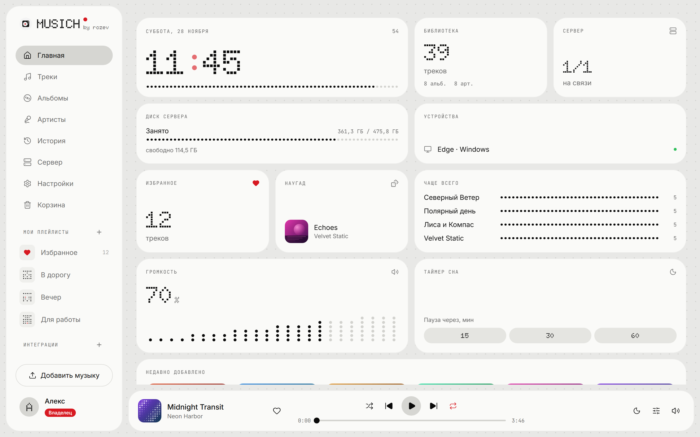
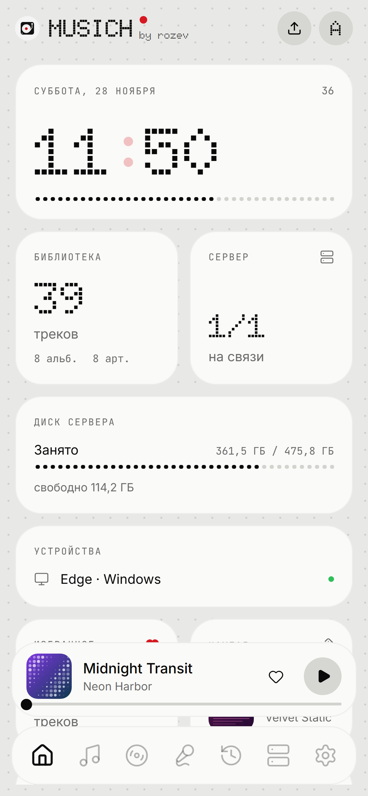
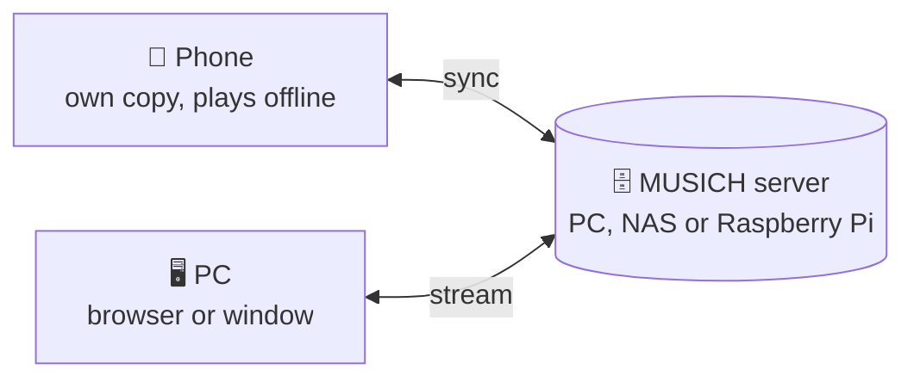

<div align="center">


# MUSICH

**Your music, at home. Your phone plays it offline.**

Streaming services cut and pull songs, and the subscription doesn’t get any cheaper.<br>
MUSICH keeps your collection on your own server or PC, and nobody gets to edit it.

[](https://github.com/rozev-and/Musich/releases/latest)
[](https://github.com/rozev-and/Musich/releases)
[](LICENSE)
[](#features)

[Русский](README.md) · **English**

<br>

<picture><source media="(prefers-color-scheme: dark)" srcset="docs/media/desktop-dark.png"></picture>&nbsp;&nbsp;<picture><source media="(prefers-color-scheme: dark)" srcset="docs/media/phone-dark.png"></picture>

</div>

<br>

## Download

<table>
<tr>
<td align="center" width="25%">
<h3>🖥 Server for Windows</h3>
An installer: click “Next” and it just works.<br>No Docker, no command line.<br><br>
<a href="https://github.com/rozev-and/Musich/releases/latest/download/MUSICH-Setup.exe"></a>
</td>
<td align="center" width="25%">
<h3>🐳 Server</h3>
Linux, NAS, Raspberry Pi —<br>one Docker command.<br><br>
<a href="#server-in-docker"></a>
</td>
<td align="center" width="25%">
<h3>💻 PC app</h3>
Your own copy of the music on your laptop,<br>plays offline.<br><br>
<a href="https://github.com/rozev-and/Musich/releases/latest/download/MUSICH-PC-Setup.exe"></a>
</td>
<td align="center" width="25%">
<h3>📱 Android</h3>
Your own copy of the music,<br>plays without internet.<br><br>
<a href="https://github.com/rozev-and/Musich/releases/latest/download/MUSICH.apk"></a><br><sub>Google Play — soon</sub>
</td>
</tr>
</table>

## Features

- 🎵 **Your own library.** mp3, flac and more, tags, covers, lyrics, playlists, history, yearly recap.
- 📴 **Phone works offline.** Plays downloaded music, keeps likes and plays, and sends them once it’s back online.
- 🏠 **At home — direct, away — through your domain.** The phone picks the route to the server by itself.
- 👨‍👩‍👧 **The whole family on one server.** Everyone has their own library, plus shared playlists.
- 🔗 **Your services alongside.** Spotify, YouTube Music, Shmyandex Music, VK: see which tracks from your playlists are missing.
- 📊 **Stats.** Scrobbling to ListenBrainz and Last.fm.
- 🎨 **Looks the way you like.** Nothing-inspired design, themes, light and dark, 8 languages.
- 🔒 **Safe.** Two-step sign-in, password-protected backups. It’s your server — your data stays with you.

## How it fits together

One server keeps the library. Your PC and phone connect to it and see the same thing.



- **No server?** Install the [Windows installer](https://github.com/rozev-and/Musich/releases/latest/download/MUSICH-Setup.exe) — your PC becomes the server. The phone finds it over Wi-Fi.
- **Have a server?** Run [MUSICH in Docker](#server-in-docker) and open it in a browser on your PC.
- **Phone only?** The app works without a server. Link one later and the libraries merge.

## Server in Docker

```bash
docker run -d --name musich --restart unless-stopped \
  -p 2290:2290 \
  -v ./music:/music -v ./data:/data \
  ghcr.io/rozev-and/musich:latest
```

Open `http://<server-address>:2290` and create an account. Music folders, users, domain — everything else is in the interface, no config files.

<details>
<summary>docker compose</summary>

```yaml
services:
  musich:
    image: ghcr.io/rozev-and/musich:latest
    restart: unless-stopped
    ports: ["2290:2290"]
    volumes:
      - ./music:/music   # music
      - ./data:/data     # database, covers, settings
```

</details>

<details>
<summary>Build from source</summary>

```bash
git clone https://github.com/rozev-and/Musich.git && cd Musich
mkdir -p music data && docker compose up -d --build
```

</details>

## FAQ

<details>
<summary><b>Is it free?</b></summary>

Yes. All the code is open: the server, the PC version and the Android app are free to download here. On Google Play the app will be paid: the same build with automatic updates, for those who want to support the project. You can also support it from the app: “Support” at the bottom of Settings.

</details>

<details>
<summary><b>Do I need internet?</b></summary>

No. At home everything works over Wi-Fi, and the phone plays downloaded music with no connection at all. You only need internet to stream from your server while away — for that the server needs a domain.

</details>

<details>
<summary><b>Where is my music stored?</b></summary>

Only with you: on your server or PC and, if you downloaded it, on your phone. MUSICH never sends it anywhere.

</details>

<details>
<summary><b>Does MUSICH change my files?</b></summary>

Your choice: tag and cover edits can be written into the files or kept only in MUSICH, leaving the originals untouched.

</details>

## Docs

[Guide (RU)](docs/GUIDE.md) · [Windows (RU)](deploy/windows/README.md) · [API](docs/API.md) · [Sync](docs/SYNC.md) · [Users](docs/USERS.md)

<br>

<div align="center">
<sub>Made by <a href="https://github.com/rozev-and">@rozev-and</a> · <a href="https://t.me/andropov_ai">Telegram</a> · <a href="LICENSE">PolyForm Noncommercial 1.0.0</a> · <a href="PRIVACY.md">Privacy</a></sub>
</div>
