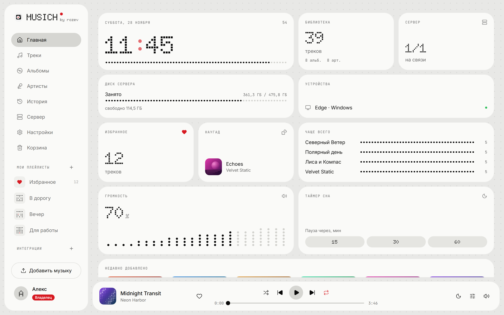
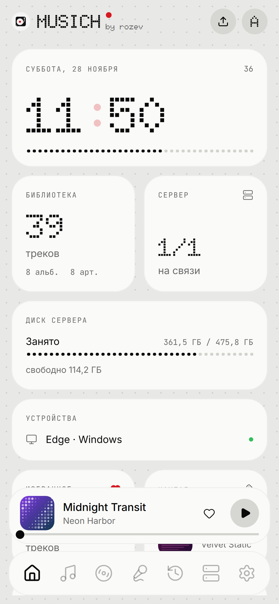
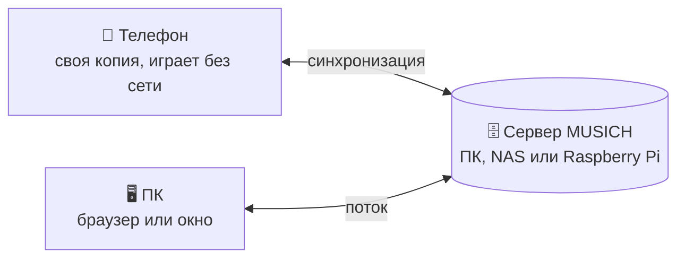

<div align="center">


# MUSICH

**Своя музыка у тебя дома. Телефон играет её без сети.**

Стриминги режут и удаляют песни, а подписка от этого не дешевеет.<br>
MUSICH хранит твою коллекцию на твоём сервере или ПК, и никто её не отредактирует.

[](https://github.com/rozev-and/Musich/releases/latest)
[](https://github.com/rozev-and/Musich/releases)
[](LICENSE)
[](#что-умеет)

**Русский** · [English](README.en.md)

<br>

<picture><source media="(prefers-color-scheme: dark)" srcset="docs/media/desktop-dark.png"></picture>&nbsp;&nbsp;<picture><source media="(prefers-color-scheme: dark)" srcset="docs/media/phone-dark.png"></picture>

</div>

<br>

## Скачать

<table>
<tr>
<td align="center" width="25%">
<h3>🖥 Сервер для Windows</h3>
Установщик: нажал «Далее» — и всё работает.<br>Без Docker и без командной строки.<br><br>
<a href="https://github.com/rozev-and/Musich/releases/latest/download/MUSICH-Setup.exe"></a>
</td>
<td align="center" width="25%">
<h3>🐳 Сервер</h3>
Linux, NAS, Raspberry Pi —<br>одной командой в Docker.<br><br>
<a href="#сервер-в-docker"></a>
</td>
<td align="center" width="25%">
<h3>💻 Приложение для ПК</h3>
Своя копия музыки на ноутбуке,<br>играет без интернета.<br><br>
<a href="https://github.com/rozev-and/Musich/releases/latest/download/MUSICH-PC-Setup.exe"></a>
</td>
<td align="center" width="25%">
<h3>📱 Android</h3>
Своя копия музыки на телефоне,<br>играет без интернета.<br><br>
<a href="https://github.com/rozev-and/Musich/releases/latest/download/MUSICH.apk"></a><br><sub>Google Play — скоро</sub>
</td>
</tr>
</table>

## Что умеет

- 🎵 **Своя библиотека.** mp3, flac и другие форматы, теги, обложки, тексты песен, плейлисты, история, итоги.
- 📴 **Телефон без сети.** Играет скачанное, копит лайки и прослушивания и отправляет их, когда связь вернётся.
- 🏠 **Дома — напрямую, вне дома — через домен.** Телефон сам выбирает путь до сервера.
- 👨‍👩‍👧 **Вся семья на одном сервере.** У каждого своя библиотека, есть общие плейлисты.
- 🔗 **Твои сервисы рядом.** Spotify, YouTube Music, Шмяндекс Музыка, VK: видно, каких треков из твоих плейлистов нет в библиотеке.
- 📊 **Статистика.** Скробблинг в ListenBrainz и Last.fm.
- 🎨 **Выглядит как хочешь.** Дизайн в духе Nothing, темы, светлый и тёмный режим, 8 языков.
- 🔒 **Безопасно.** Двухэтапный вход, бэкап с паролем. Сервер твой — данные никуда не уходят.

## Как это устроено

Один сервер хранит библиотеку. ПК и телефон к нему подключаются и видят одно и то же.



- **Нет своего сервера?** Поставь [установщик для Windows](https://github.com/rozev-and/Musich/releases/latest/download/MUSICH-Setup.exe) — твой ПК станет сервером. Телефон найдёт его сам по Wi-Fi.
- **Есть сервер?** Запусти [MUSICH в Docker](#сервер-в-docker), а на ПК открывай его в браузере.
- **Только телефон?** Приложение работает и без сервера. Сервер можно привязать потом — библиотеки объединятся.

## Сервер в Docker

```bash
docker run -d --name musich --restart unless-stopped \
  -p 2290:2290 \
  -v ./music:/music -v ./data:/data \
  ghcr.io/rozev-and/musich:latest
```

Открой `http://<адрес-сервера>:2290` и создай аккаунт. Папки с музыкой, пользователи, домен — дальше всё в интерфейсе, без конфигов.

<details>
<summary>docker compose</summary>

```yaml
services:
  musich:
    image: ghcr.io/rozev-and/musich:latest
    restart: unless-stopped
    ports: ["2290:2290"]
    volumes:
      - ./music:/music   # музыка
      - ./data:/data     # база, обложки, настройки
```

</details>

<details>
<summary>Собрать из исходников</summary>

```bash
git clone https://github.com/rozev-and/Musich.git && cd Musich
mkdir -p music data && docker compose up -d --build
```

</details>

## Частые вопросы

<details>
<summary><b>Это бесплатно?</b></summary>

Да. Весь код открыт: сервер, версия для ПК и приложение для Android — всё скачивается здесь бесплатно. В Google Play приложение будет платным: это готовая сборка с автообновлениями для тех, кто хочет поддержать проект. Ещё поддержать можно в приложении: «Поддержать» внизу «Настроек».

</details>

<details>
<summary><b>Нужен ли интернет?</b></summary>

Нет. Дома всё работает по Wi-Fi, а телефон играет скачанное вообще без сети. Интернет нужен, только чтобы слушать с сервера вне дома, — для этого серверу нужен домен.

</details>

<details>
<summary><b>Где хранится моя музыка?</b></summary>

Только у тебя: на сервере или ПК и, если скачал, на телефоне. MUSICH никуда её не отправляет.

</details>

<details>
<summary><b>MUSICH меняет мои файлы?</b></summary>

Как настроишь: правки тегов и обложек можно писать прямо в файлы или хранить только в MUSICH, не трогая оригиналы.

</details>

## Документация

[Руководство](docs/GUIDE.md) · [Windows](deploy/windows/README.md) · [API](docs/API.md) · [Синхронизация](docs/SYNC.md) · [Пользователи](docs/USERS.md)

<br>

<div align="center">
<sub>Сделал <a href="https://github.com/rozev-and">@rozev-and</a> · <a href="https://t.me/andropov_ai">Telegram</a> · <a href="LICENSE">PolyForm Noncommercial 1.0.0</a> · <a href="PRIVACY.md">Конфиденциальность</a></sub>
</div>
